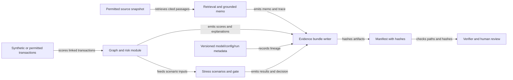

# Current architecture extension — 0.6

The historical design below remains a scope record. Current transaction inference adds `resilience.py` between calibrated estimators and review-policy application. Its public seams fit validation-only fallback policies, execute actual prediction delivery/recovery, and reconstruct archived transcripts without deserializing models. The runtime owns receipt validation, ID joins, bounded retry, quarantine and deterministic fallback. `algorithm.py` owns source training, original/protected experiment comparison, versioned artifact persistence and post-hoc metrics. The reviewer UI consumes verified artifacts.

Dependency direction: source profile → chronological split → estimator fit/calibration → validation policies → guarded test prediction → post-hoc assessment → immutable artifact manifest → semantic verification → local review/export. Test labels have no path into prediction delivery or fallback selection. Version0.6adds artifacts while retaining0.5verification. Full current protocol: [resilience spec](RESILIENCE_SPEC.md); model/monitoring protocol: [algorithm spec](ALGORITHM_FUSION_SPEC.md).

---

# Architecture Plan

> Historical scope note (2026-10-11): the lower sections record the earlier 0.1–0.3 synthetic design. For current 0.7 onboarding, use the repository README and `PROJECT_BUNDLE_V07.md`. The 0.4 ULB path is documented in `TABULAR_EVALUATION_PROTOCOL.md` and `RETRIEVAL_PROTOCOL_V04.md`.

## Chosen shape

Use a single Python package and command-line entry point. Each layer accepts immutable, versioned inputs and returns artifacts plus structured metadata to one bundle writer. The bundle manifest is the shared contract. Optional Dagster, MLflow, FAISS, graph learning and API adapters are added after the end-to-end baseline works; no external service is required to verify a local bundle.

This is a UML-like data-flow diagram for engineering and audit reviewers. Mermaid source in this file is the editable format; the text below it provides a reading alternative. An SVG export can be added when this architecture enters the white paper.

Reading alternative: versioned finance sources feed citation-producing retrieval; transaction data feeds risk scoring; risk findings also feed stress tests. The bundle writer collects those results plus run metadata, hashes each artifact into a manifest, and passes the bundle to automated and human review.

## Contracts

- Input snapshot: `{id, kind, origin, license_status, sha256, content_path}`. Synthetic data is labeled synthetic; source location and hash are mandatory.
- Finance finding: `{claim, evidence_ids[], source_hash}`. The renderer must not emit a factual claim without a matching retrieved passage.
- Risk finding: `{transaction_id, score, decision, related_entities[], explanation, model_id}`. Scores are demonstration scores until calibrated and validated.
- Run record: `{run_id, version, code_revision, utc_time, input_hashes, config_hash, seed, environment}`. Unavailable fields use explicit `null` and a reason.
- Gate record: `{scenario_id, threshold, observed, status, reason}`; status is pass/fail/incomplete.
- Manifest: schema version, project version, run ID, source classification, artifact path/hash list, limitations and verification instructions. Paths stay relative and cannot escape the bundle directory.

## Staged implementation

1. **Vertical slice:** standard-library CLI, synthetic fixture, deterministic retrieval, transparent graph rule baseline, one stress scenario, run metadata, hash manifest and verifier. This proves the contract, not model quality.
2. **Data and benchmark:** adopt rights-cleared financial and transaction datasets; freeze splits/seeds; add multiple baselines and raw prediction files. Evaluate PR-AUC, F1 and Recall@FPR only when labels and definitions support them.
3. **Model/governance adapters:** graph learning, model registry, orchestration, drift and lineage. Keep adapters optional so local reproduction remains possible.
4. **Demo and release:** API/UI, container/CI, governance documents, white paper, evidence index and release archive after measured results and rights checks.

## Error and integrity policy

Fail closed on missing inputs, hash mismatch, unrecognized license status or incomplete release evidence. No network fetch in the deterministic example. Bundle creation uses a unique run directory and refuses to overwrite. Code, data and model versions are recorded separately. Do not import or copy the legacy GraphRiskOps scaffold until its contents and any transitive source are individually reviewed.
